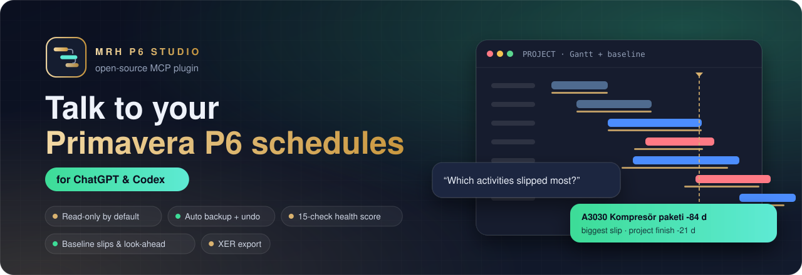
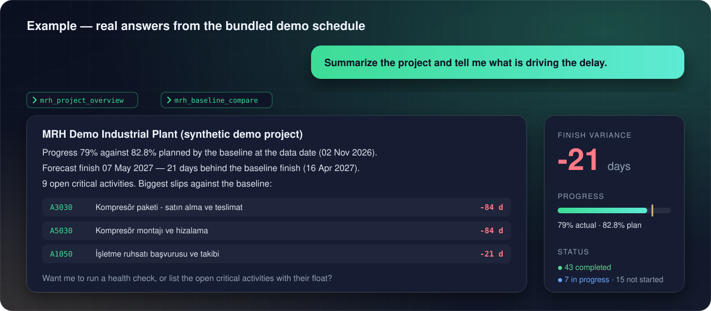
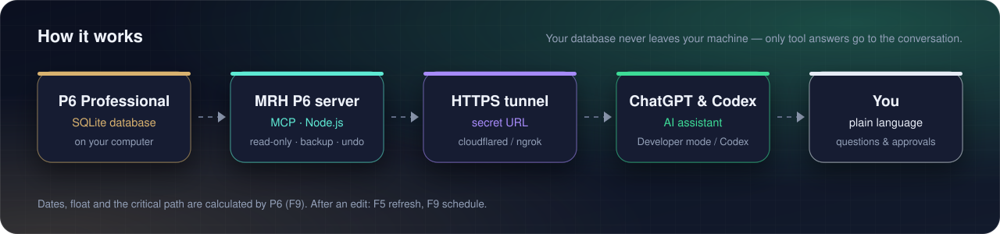
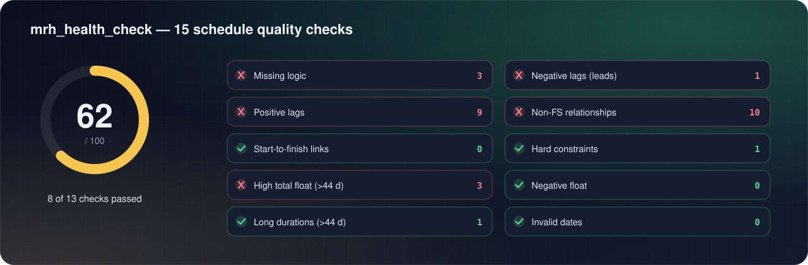

<p align="center"></p>

<h1 align="center">MRH P6 Studio for ChatGPT & Codex</h1>

<p align="center"><b>Talk to your Primavera P6 schedules in ChatGPT or OpenAI Codex — an open-source MCP server.</b></p>

<p align="center">
  <a href="LICENSE"></a>
  
  
  
  
</p>

## Why MRH P6 Studio?

Planners spend hours clicking through layouts, filters and reports to answer simple questions. MRH P6 Studio lets your AI assistant read the schedule for you — straight from the P6 Professional database on your computer.

- 🔎 **Ask anything** — *"What is driving the delay?"*, *"Which critical activities start next month?"*, *"Show the 10 worst slips against the baseline."*
- 🩺 **Schedule health in one call** — 15 quality checks (logic, leads/lags, constraints, float, durations, invalid dates, loops…) with a 0–100 score and the exact activities to fix.
- 📈 **Progress vs. baseline** — duration-weighted progress, planned progress at the data date, forecast vs. baseline finish, per-WBS progress.
- ✏️ **Safe edits when you allow them** — update progress for hundreds of activities in one transaction, add/remove activities and links, set the data date. Preview first, automatic backup, one-step undo.
- 📤 **XER export** — with Turkish, Western-European or UTF-8 encoding.
- 🔒 **Private & local** — read-only by default, no cloud service of ours, zero npm dependencies, MIT licensed.

## See it in action

<p align="center"></p>

## ⚡ Option A — Codex CLI (local, simplest)

Codex starts local MCP servers itself. Download this repository (**Code → Download ZIP**, or `git clone https://github.com/merihdogan/Mrh-P6-Studio-ChatGPT`), then add to `~/.codex/config.toml`:

```toml
[mcp_servers.mrh-p6]
command = "node"
args = ["C:/path/to/Mrh-P6-Studio-ChatGPT/mrh/mrh-mcp.js"]
env = { MRH_EDIT = "0" }   # "1" to allow editing
```

Check with `codex mcp list`, then ask: *"Open C:\\P6\\PPMDBSQLite.db and summarize the project."*

## 🌐 Option B — ChatGPT (web & desktop)

ChatGPT cannot start programs on your computer — it talks to MCP servers over **HTTPS**. Run MRH P6 Studio in HTTP mode and expose it through a tunnel:

1. **Start the server** — double-click `mrh-chatgpt-baslat.cmd` (Windows) or run `./mrh-chatgpt-baslat.sh`.
   It prints a private address like `http://127.0.0.1:4791/mcp/<secret>` (the secret is created once and reused).
2. **Open an HTTPS tunnel** to port 4791 with a tool you trust:
   ```bash
   cloudflared tunnel --url http://127.0.0.1:4791
   ```
   or `ngrok http 4791` — you get an `https://…` host.
3. **Add the connector in ChatGPT** — turn on **Developer mode** (Settings → Apps & Connectors → Advanced) and create a custom MCP connector with
   URL `https://<tunnel-host>/mcp/<secret>` and **no authentication**.
   OpenAI moves these menus from time to time — if you can't find them, search the ChatGPT Help Center for *"custom MCP connector"*. Custom connectors need a paid plan; on Business/Enterprise an admin may have to allow them.
4. **Chat** — enable the connector in a conversation and ask about your schedule.

> 🔐 The secret in the URL is the only key — treat it like a password, keep editing off unless you need it, and stop the server and tunnel when you are done.

## How it works

<p align="center"></p>

## Schedule health in one call

<p align="center"></p>

## What you can ask

> *"Open C:\\P6\\PPMDBSQLite.db and summarize the project that is open in P6."*
> *"Which critical activities finish in the next 3 weeks?"*
> *"Compare with the baseline and list the 10 activities that slipped most, with their WBS."*
> *"Run a schedule health check and explain the failed checks in plain language."*
> *"Find in-progress activities with zero remaining duration."*
> *"Mark A1020 complete with actual dates 3–14 March, then show me what changed."* ✏️
> *"Export the project to XER for the client."*

## Tools

| Tool | What it does |
|---|---|
| `mrh_db_find` | List P6 SQLite (.db/.sqlite) files in a folder. |
| `mrh_db_open` | Open a Primavera P6 Professional SQLite database by full path. |
| `mrh_project_list` | List the projects in the open database with data date, finish, baseline project and activity count.. |
| `mrh_project_overview` | Progress (duration weighted), planned progress from the baseline, forecast vs baseline finish, status counts, critical/negative-float counts and progress per top-level WBS.. |
| `mrh_activity_search` | Filter and list activities. |
| `mrh_activity_get` | Full details of one activity: dates, durations, float, constraints, predecessors and successors, resource assignments, activity codes, user fields and notes.. |
| `mrh_health_check` | Run 15 schedule quality checks (missing logic, leads, lags, non-FS links, hard constraints, high/negative float, long durations, invalid dates, status errors, duplicate links, loops, redundant links, critical activities) and return a 0-100 score with sample activity codes per check.. |
| `mrh_baseline_compare` | Activities whose current finish is later than the baseline finish, worst first.. |
| `mrh_lookahead` | Activities that start or finish within N days after the data date.. |
| `mrh_sql_read` | Run one read-only SELECT/WITH query on the P6 database (P6 table names such as TASK, TASKPRED, PROJWBS, CALENDAR, RSRC, TASKRSRC). |
| `mrh_xer_export` | Write a project to an XER file (the database is not changed). |
| `mrh_backup_list` | List the automatic backups of the open database (taken before edits, kept next to the database in mrh_yedekler).. |
| `mrh_activity_update` ✏️ | Apply the same changes to one or many activities in ONE transaction (all or nothing). |
| `mrh_activity_create` ✏️ | Create a not-started activity (code is generated when omitted). |
| `mrh_activity_delete` ✏️ | Delete activities together with their links, resource assignments, codes, user field values and notes. |
| `mrh_link_add` ✏️ | Add a relationship between two activities. |
| `mrh_link_update` ✏️ | Change the type and/or lag of a relationship (link_id from mrh_activity_get).. |
| `mrh_link_delete` ✏️ | Delete relationships by link_id (from mrh_activity_get).. |
| `mrh_data_date_set` ✏️ | Set the project data date (YYYY-MM-DD). |
| `mrh_undo` ✏️ | Revert the last edit made in this session. |

✏️ = editing tool — only listed when editing is enabled (`MRH_EDIT=1`).

## Safety first

| | |
|---|---|
| 🔒 **Read-only by default** | Editing tools are hidden until you enable them. |
| 💾 **Automatic backup** | A compressed copy is written next to the database (`mrh_yedekler\\<name>`) before the first edit of a session. |
| ⚛️ **All or nothing** | Every edit runs in one transaction; one invalid activity rolls the whole change back. |
| ↩️ **Undo** | `mrh_undo` reverts the last edit and refuses if the same rows were changed elsewhere afterwards. |
| ✅ **P6 rules** | Status/actual-date consistency, milestone rules, duplicate codes and loop-creating links are refused; new IDs follow P6's own key counters. |

Dates, float and the critical path are calculated by P6 — after editing press **F5** (refresh) and **F9** (schedule).
Direct database edits bypass P6's own validation and are not supported by Oracle: **try it on a copy first**, and check that sharing project data with an AI service is allowed by your company.

## Requirements

- **Node.js 22.13+** (uses the built-in `node:sqlite`, no npm packages) — check with `node --version`.
- A Primavera **P6 Professional SQLite** database (SQL Server / Oracle databases are not supported).
- Windows, macOS or Linux.

## Try it without P6

```bash
node araclar/dgn-demo-olustur.js ornek/mrh-demo.db
```

Creates a synthetic demo schedule (65 activities, WBS, progress, a baseline, resources and codes) — the examples on this page come from it.

## Development

```bash
npm test
```

The server is a single dependency-free Node.js program in [`mrh/`](mrh): `mrh-mcp.js` (MCP over stdio and Streamable HTTP), `dgn-p6.js` (schema-adaptive P6 reader), `dgn-yazim.js` (edit rules), `dgn-kontrol.js` (health checks), `dgn-ozet.js` (overview), `dgn-xer.js` (XER export) and `mr-yedek.js` (backups).

## 🇹🇷 Türkçe

**MRH P6 Studio**, Primavera P6 Professional SQLite veritabanınızı **ChatGPT ve Codex** ile konuşarak incelemenizi ve izin verirseniz güvenle düzenlemenizi sağlayan açık kaynak bir MCP eklentisidir.

- 🔎 *"Gecikmeye ne sebep oluyor?"*, *"Önümüzdeki ay başlayacak kritik aktiviteler hangileri?"*, *"Tabana göre en çok kayan 10 aktivite?"* gibi sorulara doğrudan veritabanından cevap verir.
- 🩺 **Plan sağlığı:** 15 kontrol, 0–100 puan ve düzeltilecek aktivitelerin listesi.
- 📈 **İlerleme ve taban karşılaştırması:** süre ağırlıklı ilerleme, veri tarihindeki planlı ilerleme, tahmini bitiş ve sapma, WBS bazında ilerleme.
- ✏️ **Güvenli düzenleme:** yüzlerce aktivitenin ilerlemesini tek işlemde günceller; önizleme, otomatik yedek ve tek adımda geri alma vardır.
- 🔒 Varsayılan olarak **salt okunurdur**; düzenleme için `MRH_EDIT=1` gerekir. Ek paket yoktur, MIT lisanslıdır.

**Kurulum:** **Codex CLI:** yukarıdaki `config.toml` satırlarını ekleyin (yerelde çalışır). **ChatGPT:** `mrh-chatgpt-baslat.cmd` ile sunucuyu başlatın, `cloudflared tunnel --url http://127.0.0.1:4791` ile HTTPS tüneli açın, ChatGPT'de Geliştirici modunu açıp bağlayıcı adresi olarak `https://<tünel>/mcp/<gizli-anahtar>` girin. Bu adres bir parola gibidir; kimseyle paylaşmayın.

Gereksinim: **Node.js 22.13+**. Düzenlemeden sonra P6'da **F5** ve **F9** yapın. İlk denemeyi veritabanınızın bir **kopyası** üzerinde yapın.

## The MRH P6 Studio family

| | |
|---|---|
| 🟠 **Claude** (Claude Code & Desktop) | [Mrh-P6-Studio-Claude](https://github.com/merihdogan/Mrh-P6-Studio-Claude) |
| 🟢 **ChatGPT & Codex** | **you are here** |
| 🔵 **Gemini CLI** | [Mrh-P6-Studio-Gemini](https://github.com/merihdogan/Mrh-P6-Studio-Gemini) |

All three share the same open-source server; only the packaging differs.

---

<p align="center"><sub>Made with care by <b>Merih Doğan</b> · MIT License<br>
Primavera and P6 are trademarks of Oracle and/or its affiliates. Claude, ChatGPT, Codex and Gemini are trademarks of their respective owners.
MRH P6 Studio is an independent project, not affiliated with or endorsed by Oracle, Anthropic, OpenAI or Google.</sub></p>
